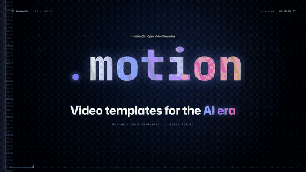
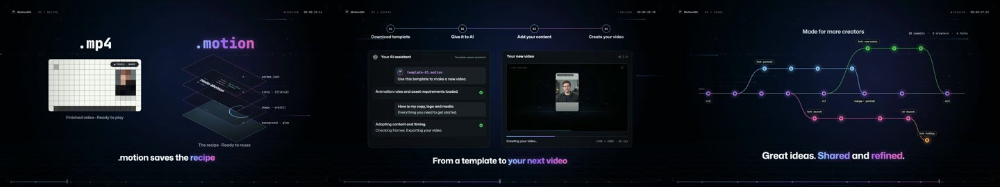

<a href="https://motiongit.com/@motiongit/motiongit-promo-main"></a>

# 多屏拼贴 · 品牌宣传

用多屏拼贴、版面切换和品牌收尾展示产品与创作流程，适合品牌介绍和工具宣传。

**16:9 · 1920 × 1080 · 57s · 60 fps** &nbsp; / &nbsp; [@motiongit](https://motiongit.com/@motiongit)

[**到 MotionGit 获取模板 ↗**](https://motiongit.com/@motiongit/motiongit-promo-main) · [English](README.md)

> 下载已开放 · 许可以官网为准. 开放状态以官网为准；先注册、登录，在下载开放后获取自己的 .motion。

## Demo

[](https://motiontemplates.github.io/128610/)

[观看官网样片](https://media.openaicut.com/previews/585/draft-en-3d2b6bdce3c7.mp4)



## 准备什么

- **必需:** Sourceedits：内容，最多 0 项。
- **必需:** Voiceover：文字，不超过 240 个字符。
- **必需:** Voiceovermode：文字。
- **必需:** Soundtrackmode：文字。
- **必需:** Music：文字，不超过 240 个字符。
- **必需:** Wall00：内容组。
- **必需:** Wall01：内容组。
- **必需:** Wall02：内容组。
- **必需:** Wall03：内容组。
- **必需:** Wall04：内容组。
- **必需:** Wall05：内容组。
- **必需:** Wall06：内容组。
- **必需:** Wall07：内容组。
- **必需:** Wall08：内容组。
- **必需:** Wall09：内容组。
- **必需:** Wall10：内容组。
- **必需:** Wall11：内容组。
- **必需:** Demo：内容组。
- **必需:** Portrait：内容组。
- **必需:** Ast 01：文字，不超过 64 个字符。
- **必需:** Ast 02：文字，不超过 64 个字符。
- **必需:** Ast 03：文字，不超过 64 个字符。
- **必需:** Ast 04：文字，不超过 64 个字符。
- **必需:** Ast 05：文字，不超过 64 个字符。

Fixed57s landscape product film using current copy, brand artwork, graph labels and supplied image/video carriers. Preserve source scene order, motion and independent SFX..

## 让 AI 引导你

把仓库地址和这段话发给 Codex、豆包或其他助手：

```text
https://github.com/motiontemplates/128610
引导我用这个模板开始制作。帮我准备素材，到 MotionGit 注册并在开放后下载 .motion，再按实际模板检查依赖，先审阅计划和预览。
```

**AI 助手：**先读 [制作引导](ASSISTANT.zh-CN.md)，引导用户到上面的官网模板页面获取真实包。尚未开放时先整理简报与素材。

## 制作环境

- 模板声明使用 Python 和 Node.js。具体工具与版本以下载包为准。
- 按下载包的依赖锁和 setup/check 说明检查已有工具，只补齐缺项，并验证预览。

首次配置可能较久。让助手先检查已有环境，只补齐缺项并验证短预览，后续复用。

## 关于 .motion

MP4 是成片；**.motion 是可复用的视频制作模板**，将动画工程、内容槽位、素材、依赖与说明组织在一起，让你用自己的内容再次制作。 [格式协议 ↗](https://motiongit.com/spec)

MotionGit 还提供素材匹配、生图、配音与配乐查找等配套能力，按实际槽位、账号权限和报价使用。

---

本仓库发布介绍和公开样片；模板源码与个人下载包不在这里。实际制作从 [MotionGit](https://motiongit.com/@motiongit/motiongit-promo-main).
